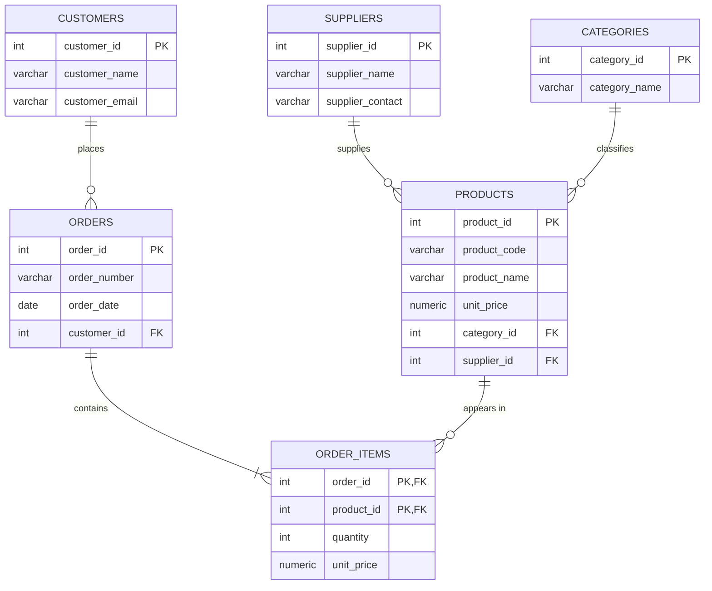

# AeroGlobal In-Flight E-Commerce: Database Design Explanation

## 1. Email to the Sales Team

**To:** AeroGlobal Sales Team
**From:** Database Team (on behalf of Kenji Sato, Lead Database Architect)
**Subject:** How we will model your in-flight shop data: ERDs, entities and why the spreadsheet has to go

Hi team,

Thank you for the mockup of the new in-flight e-commerce feature; it gave us a clear picture of what you want to sell and track. Before we build anything, we want to share how we plan to organise the data. We start by drawing an **Entity-Relationship Diagram (ERD)**, which is a map of the business. It shows the main "things" we keep information about and how they connect, for example *a customer places many orders* and *an order contains many products*. Each of these "things" is an **entity**: one real-world object or concept that matters to the business, such as a Customer, an Order, a Product or a Supplier. Every entity becomes its own table in the database, with one row per individual item (one row per customer, one row per product) and one column per detail we store about it (name, email, price).

Your current spreadsheet is what we call a **flat file system**: everything sits in one big table, so the same customer, product and supplier details are typed again on every row. That causes real problems. Alice Johnson's name and email appear on four separate rows, and if she changes her email we must find and fix every copy. If one copy is missed, the sales data disagrees with itself. We also cannot add a new product or supplier until someone buys it, and deleting an order can accidentally erase the only record we hold of a customer. A flat file also gives no protection against typos, missing values or half-saved orders, and it gets slower and harder to share as more people use it.

The structured approach fixes this by storing each fact **once**, in the table that owns it, and linking tables together with unique ID numbers (keys). A customer's email lives in one place and every order simply points to that customer. The database software (a DBMS, PostgreSQL in our case) then enforces the rules automatically: required fields cannot be left empty, an order cannot belong to a customer who does not exist, and an order is saved completely or not at all. The result is cleaner reports, fewer mistakes and a foundation that can grow with the in-flight shop. The detailed review of your data and our proposed design are below.

Best regards,
The Database Team

---

## 2. Problems Found in `draft_schema.csv`

The spreadsheet has 20 rows (order lines) covering 15 orders. We found these specific issues:

| # | Type | Evidence in the file | Why it is a problem |
|---|---|---|---|
| 1 | **Redundant customer data** | Alice Johnson's name and email (`alice.j@example.com`) are repeated on 4 rows (ORD-5001 twice, ORD-5004, ORD-5012). Carlos, Priya, Lars, Wei and Maria each repeat on 2 rows. | Wasted space and many copies that can drift apart. |
| 2 | **Redundant product data** | "In-Flight Wi-Fi (24h)" (PROD-103) with its category, supplier and contact is copied on 5 rows. The Noise-Canceling Headphones are copied on 3 rows. | Every sale re-types the whole product description. |
| 3 | **Redundant supplier data** | SkyTech Audio and `contact@skytechaudio.com` appear on 5 rows (PROD-101 and PROD-106); AeroNet Comms on 5 rows. | Supplier details belong to the supplier, not to each sale. |
| 4 | **Update anomaly** | If SkyTech Audio changes its contact email, 5 rows must all be edited. Missing one leaves two different contacts for the same supplier. | Inconsistent data. |
| 5 | **Insert anomaly** | A new product, supplier or customer cannot be recorded until an order exists for it, because every row requires an `OrderID`. | We cannot build the catalogue ahead of sales. |
| 6 | **Delete anomaly** | James Smith appears only on ORD-5014. Deleting that order also deletes everything we know about James. | Accidental loss of customer information. |
| 7 | **Repeated order data** | Orders with several products (e.g. ORD-5001, ORD-5003, ORD-5006, ORD-5008, ORD-5010) repeat the order date and customer on every line. | The same order fact is stored more than once. |
| 8 | **Derived / ambiguous price** | `TotalPrice` is quantity × unit price, but the unit price is not stored. The Premium Sleep Mask shows 30.00 on one row and 15.00 on another (quantity 2 vs 1). | Calculated values go stale, and the real price per item is hidden. |

### How normalization fixes them

- **1NF:** every cell already holds one value, and each row is identified by the combination `OrderID + ProductID`.
- **2NF:** customer name, email and order date depend only on the order, and product, category and supplier details depend only on the product; neither depends on the whole combined key. We move them into their own tables (`customers`, `orders`, `products`).
- **3NF:** supplier contact depends on the supplier, and category depends on the product's classification, not on the sale; `TotalPrice` is derived from quantity and price. We create `suppliers` and `categories` tables and remove `TotalPrice`, calculating it when needed.

---

## 3. Proposed 3NF Schema

### Entity-Relationship Diagram

### Tables

#### `customers` (entity: a person who buys)
- **Primary key:** `customer_id`
- **Foreign keys:** none
- **Columns:** `customer_id`, `customer_name` (NOT NULL), `customer_email` (NOT NULL, UNIQUE)

#### `suppliers` (entity: a company that supplies products)
- **Primary key:** `supplier_id`
- **Foreign keys:** none
- **Columns:** `supplier_id`, `supplier_name` (NOT NULL, UNIQUE), `supplier_contact` (NOT NULL)

#### `categories` (entity: a product grouping)
- **Primary key:** `category_id`
- **Foreign keys:** none
- **Columns:** `category_id`, `category_name` (NOT NULL, UNIQUE)

#### `products` (entity: an item for sale)
- **Primary key:** `product_id`
- **Foreign keys:** `category_id` → `categories(category_id)`; `supplier_id` → `suppliers(supplier_id)`
- **Columns:** `product_id`, `product_code` (e.g. PROD-101, UNIQUE), `product_name` (NOT NULL), `unit_price` (NOT NULL, ≥ 0), `category_id`, `supplier_id`

#### `orders` (entity: one purchase)
- **Primary key:** `order_id`
- **Foreign keys:** `customer_id` → `customers(customer_id)`
- **Columns:** `order_id`, `order_number` (e.g. ORD-5001, UNIQUE), `order_date` (NOT NULL), `customer_id` (NOT NULL)

#### `order_items` (links orders and products; one row per product on an order)
- **Primary key:** composite (`order_id`, `product_id`)
- **Foreign keys:** `order_id` → `orders(order_id)`; `product_id` → `products(product_id)`
- **Columns:** `order_id`, `product_id`, `quantity` (NOT NULL, > 0), `unit_price` (NOT NULL, price charged at purchase time)

### Relationships

| Relationship | Cardinality |
|---|---|
| Customer → Orders | one-to-many |
| Order → Order items | one-to-many |
| Product → Order items | one-to-many (so Orders ↔ Products is many-to-many through `order_items`) |
| Supplier → Products | one-to-many |
| Category → Products | one-to-many |

### Design notes

- **Surrogate integer keys:** the original IDs (`ORD-5001`, `PROD-101`) are kept as unique `order_number` and `product_code` columns, while internal integer keys are used for joins.
- **`unit_price` in `order_items`:** it records what the customer actually paid, so a later catalogue price change does not rewrite history. It does not break 3NF, because it depends on the specific order line.
- **`TotalPrice` removed:** the line total is calculated with `quantity * unit_price` when a report needs it.

### Validation

`schema.sql` was run on PostgreSQL 16. All 20 rows of `draft_schema.csv` were loaded into the six tables (8 customers, 5 suppliers, 6 categories, 7 products, 15 orders, 20 order lines), and a join reproduced the original spreadsheet exactly. A bad order (item pointing to a non-existent product) was rejected and rolled back, and the `NOT NULL` and `UNIQUE` rules rejected incomplete or duplicate customers.
